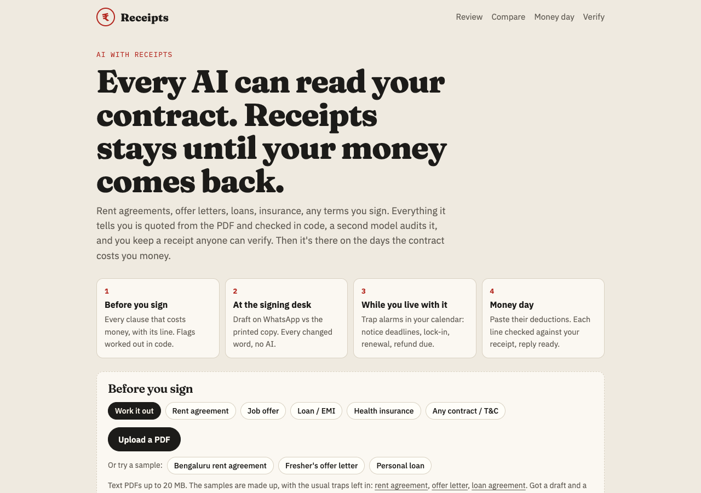
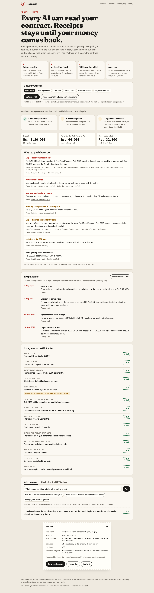
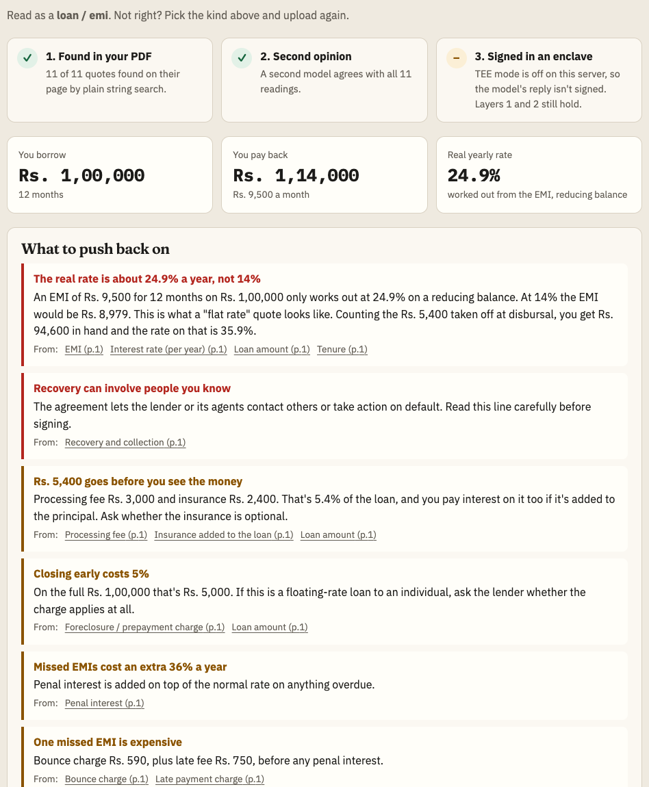
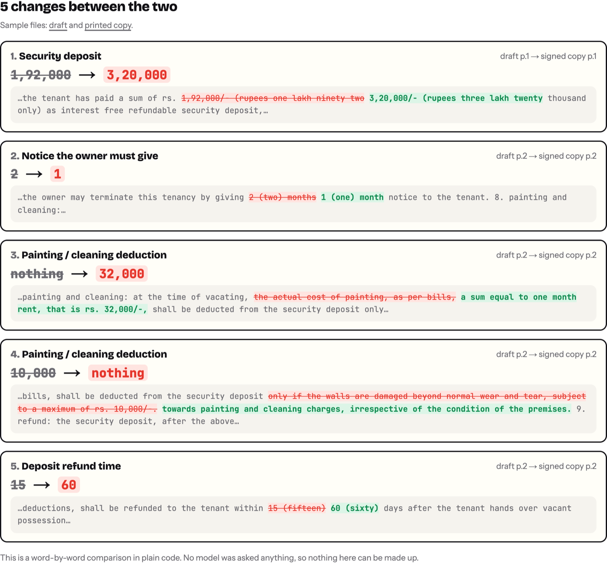
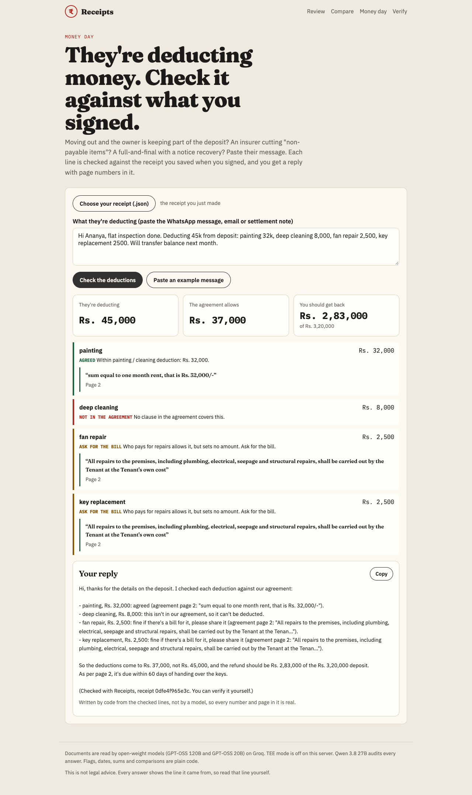
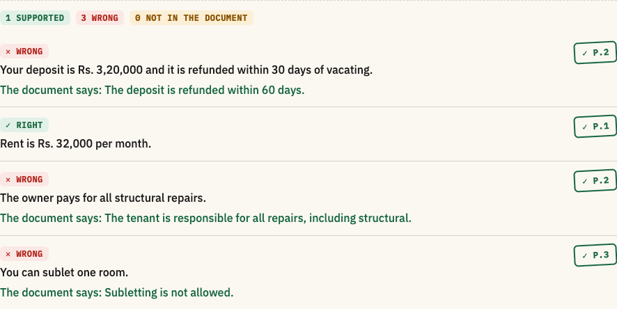

# Receipts

**Every AI can read your contract. Receipts stays until your money comes back.**

People don't lose money on the day they read a contract. They lose it at the signing desk, when the printed copy isn't the draft they agreed to. Months later, they miss a notice deadline. On the last day, a landlord deducts Rs. 45,000 from the deposit and dares them to argue.

Receipts covers all of those days. It reads rent agreements, offer letters, loans, health insurance and any other terms you sign. Everything it tells you is quoted from the PDF and checked in code, and a second model audits it. You keep a **receipt**: a file anyone can verify later, with no AI involved in the checking.

Built for Hacktoberfest Hack Day Bengaluru 2026.

- **Track:** 02, Best Open-Source AI Project
- **Problem statement:** O3, Trustworthy and Verifiable AI



## The four moments

| When | What Receipts does | Who decides |
| --- | --- | --- |
| **Before you sign** | Picks the kind of document (rent, job offer, loan, health insurance, any contract) and reads out the clauses that cost money. Each one comes with its line and page. Flags what to push back on. | Model reads, **code** checks every quote and works out every flag |
| **At the signing desk** | *Printed ≠ promised.* Compares the draft from WhatsApp with the copy on stamp paper, word by word, and shows every change with its page in both. | **Code only**, no model |
| **While you live with it** | *Trap alarms.* A calendar file with the days the contract costs you money: last day to give notice, lock-in ends, renewal, deposit refund due, rent day. | **Code**, from verified dates |
| **Money day** | Paste the landlord's WhatsApp ("deducting 45k: painting 32k, cleaning 8k…"). Each line is checked against the receipt you saved at signing: agreed, over the limit, not in the agreement, or ask for the bill. You get a reply with page numbers in it. | Model splits the message, **code** decides and writes the reply |

Also: **ask the document anything** (every sentence of the answer carries its own proof), and **check what ChatGPT told you** about it (each claim comes back right, wrong or not in the document).

## Examples from the samples

All samples are invented and live in [`public/`](public).

**Rent agreement:**
- Deposit is 10 months of rent, Rs. 2,56,000 above the Model Tenancy Act's two-month line (Section 11).
- A Rs. 32,000 painting cut "irrespective of the condition".
- You give 2 months' notice, the owner gives 1.
- You pay for structural repairs.



**Personal loan at "14% flat":**
- The code redoes the EMI maths: the real rate is **24.9%**.
- Counting the Rs. 5,400 taken off at disbursal, it's **35.9%** on the money actually in hand.



**Fresher's offer letter:**
- A Rs. 2,00,000 training bond.
- A 90-day notice period. Buying it out costs about Rs. 1,18,356.
- 18% of the CTC isn't guaranteed.
- A non-compete (Indian Contract Act, Section 27).

**Draft vs printed:** 5 quiet changes between the two copies:
- deposit 1,92,000 → 3,20,000
- owner's notice 2 months → 1
- painting "as per bills, max 10,000" → "one month's rent irrespective of condition"
- refund 15 days → 60



**Money day:** Rs. 45,000 claimed, Rs. 37,000 allowed, Rs. 2,83,000 owed back, and a reply ready to paste.



## Why you can trust it

Three layers. Each one can be checked by someone who doesn't trust the one before it.

| Layer | What it proves | How |
| --- | --- | --- |
| 1. Found in your PDF | The line exists and the number is in it | Plain code finds every quote on its page (exact, or 85% of its words close together) and checks the amount is written in the quote. If not, the model is shown the page and asked once more (self-correction). If it still can't point at the line, the answer gets a red **? check** stamp. |
| 2. Second opinion | The line was read the right way | Qwen, a different model family, reads each verified quote next to the answer and says whether the quote supports it. It catches a real line read wrongly. |
| 3. Read inside an enclave | The document was read by known, published code on genuine enclave hardware, and nobody else could see it | In TEE mode, GPT-OSS 120B runs inside a hardware enclave. With **Tinfoil** (free to start), the SDK checks the enclave's attestation before connecting: the measured code must match Tinfoil's published release. It then encrypts the request to that enclave's key, and the receipt records the fingerprints and release. With a **signing provider** (RedPill / Phala), the enclave signs `sha256(request):sha256(response)`; the app checks the ECDSA signature recovers to the enclave's address, and that the attestation report (fetched with a fresh nonce) names it. The auditor stays on Groq and only ever sees the short quotes. |

On top of that:

- **Flags, dates, sums and diffs are plain code.** The model only reads text out. The rules live in [`lib/packs/`](lib/packs), one file per kind of document, and only run on verified clauses, so every flag links to a real line.
- **The receipt** holds the PDF's sha256, a hash of every page, every clause with its quote, page, stamp and audit, the flags, and any enclave proofs, all under one canonical digest. The format is documented in [RECEIPT_SPEC.md](RECEIPT_SPEC.md) so other tools can write and check receipts too.
- **The verify page uses no model.** It re-hashes the receipt, checks each amount is in its own quote, finds every quote in the PDF again, and re-checks the enclave signatures and that the clauses match the signed reply. The **Tamper with it** button changes one number so you can watch it fail.



## Open-source and open-weight

- GPT-OSS 120B and GPT-OSS 20B read the documents. Qwen 3.8 27B audits.
- They're served free on Groq by default, by any OpenAI-compatible server (Ollama, vLLM, llama.cpp) with `LLM_BASE_URL`, or inside a TEE with `TINFOIL_API_KEY` or `TEE_BASE_URL`.
- All code is MIT.
- Adding a new kind of document means writing one file in `lib/packs/`: its clauses, its rules and its summary.

## Run it

```bash
npm install
cp .env.example .env   # add GROQ_API_KEY (free at console.groq.com)
npm run dev            # http://localhost:4300
npm test               # quote checks, packs, loan maths, diff, alarms, receipts, signatures
```

TEE mode, free to start with [Tinfoil](https://tinfoil.sh) (Dashboard → API keys, no card):

```bash
TINFOIL_API_KEY=...
```

Or a provider that signs each reply (RedPill / Phala style, `/signature/{id}` and `/attestation/report`):

```bash
TEE_BASE_URL=https://api.redpill.ai/v1
TEE_API_KEY=...
TEE_MODEL=openai/gpt-oss-120b
```

`npm run sample` rebuilds the sample PDFs.

## How it's built

- Next.js 16, plain CSS, no database. Uploaded documents stay in memory for an hour for follow-up questions, and nothing is written to disk.
- [`lib/pdf.js`](lib/pdf.js), [`lib/search.js`](lib/search.js), [`lib/verify.js`](lib/verify.js):
  - text per page with unpdf
  - BM25 to pick the passages each question needs
  - quote matching that survives line breaks, odd quote marks and Indian number formats
- [`lib/reader.js`](lib/reader.js): two reads in parallel, quote checks, one self-correcting retry.
- [`lib/packs/`](lib/packs): rent, job offer, loan (EMI and implied-rate maths), health insurance, any contract.
- [`lib/diff.js`](lib/diff.js): word diff of two PDFs, each change tied to a clause.
- [`lib/alarms.js`](lib/alarms.js): dates from verified clauses, exported as `.ics`.
- [`lib/settle.js`](lib/settle.js): deductions checked against a receipt, reply written by code.
- [`lib/ask.js`](lib/ask.js): ask, and fact-check another AI.
- [`lib/auditor.js`](lib/auditor.js), [`lib/tee.js`](lib/tee.js), [`lib/receipt.js`](lib/receipt.js): the second opinion, the enclave proofs and the receipt.

The PDF, search and quote-matching code started from my earlier project [Form Bhaiya](https://github.com/abjt01/form-bhaiya) (MIT, built 14 October 2026), which checks government exam notices the same way. Everything else is new here.

## Limits

- Text PDFs only. A scanned document has no text to quote, and this app doesn't pretend to OCR it.
- Flags are a starting point for a conversation, not legal advice. The only legal references are the Model Tenancy Act, 2021 (Section 11) and the Indian Contract Act, 1872 (Section 27), each with a note on how far it goes.
- Without TEE mode, layer 3 is off and the app says so on screen. Layers 1 and 2 still hold.

## License

MIT
