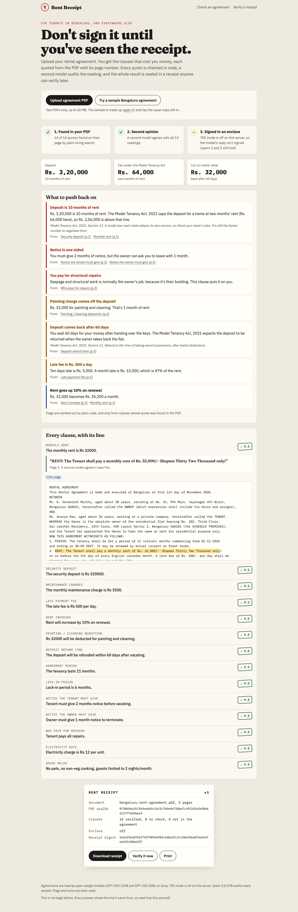
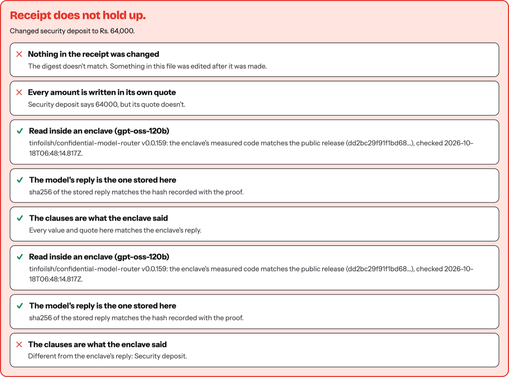

# Rent Receipt

**Don't sign it until you've seen the receipt.**

Rent Receipt reads a rental agreement for the tenant. It pulls out the clauses that cost money (deposit, lock-in, painting cuts, notice, refund time, repairs), points at the exact line and page for each one, and flags what to push back on. Then it seals everything in a **receipt**: a JSON file anyone can verify later, with no AI involved in the checking.

Built for Hacktoberfest Hack Day Bengaluru 2026.

- **Track:** 02, Best Open-Source AI Project
- **Problem statement:** O3, Trustworthy and Verifiable AI



## The problem

Bengaluru rent agreements are a few pages of stamp-paper English that brokers print and tenants sign in ten minutes. That's where the traps live: a deposit of 10 months' rent, a month's rent cut for "painting" whatever the condition of the flat, a notice period that binds only the tenant, and structural repairs pushed onto whoever lives there.

Asking a chatbot doesn't help much, because you can't tell when it's wrong. It can say your deposit comes back in 30 days when the agreement says 60, and sound just as sure.

## How it earns trust

Three layers, and each one can be checked by someone who doesn't trust the one before it.

| Layer | What it proves | How |
| --- | --- | --- |
| 1. Found in your PDF | The line exists and the number is in it | Every clause comes with a quote and a page. Plain code finds the quote on that page (exact, or 85% of its words close together) and checks the amount is written in the quote. If it isn't, the model is shown the page and asked once more. If it still can't point at the line, the clause gets a red **? check** stamp instead of an answer. |
| 2. Second opinion | The line was read the right way | A model from a different family (Qwen) gets each verified quote next to the answer and says whether the quote supports it. This catches a real line read wrongly, like the owner's notice shown as the tenant's. |
| 3. Signed in an enclave | This model, on genuine hardware, produced this reply, and nobody saw the agreement | In TEE mode the agreement is read by an open model running in a GPU trusted execution environment. The enclave signs `sha256(request):sha256(response)`. The app checks the ECDSA signature recovers to the enclave's signing address, and that the attestation report (fetched with a fresh nonce) names that address. |

On top of that:

- **Flags are plain code, not AI.** The model only reads numbers out. Rules in [`lib/rules.js`](lib/rules.js) do the maths, and only on verified clauses, so every flag links to a real line. The one legal reference is the Model Tenancy Act, 2021, Section 11 (deposit capped at two months' rent for a home), and the app says it's a model law each state adopts in its own form.
- **The receipt.** One JSON file with the PDF's sha256, a hash of every page, every clause with its quote, page, stamp and audit, the flags, and the TEE proofs, all under one canonical digest.
- **The verify page uses no model.** Upload a receipt (and optionally the PDF) at `/verify`. It re-hashes the receipt, checks each amount is in its own quote, finds every quote in the PDF again and re-checks the enclave signatures. The **Tamper with it** button edits one number so you can watch it fail.



## Open-source and open-weight

Every model is open-weight: GPT-OSS 120B and GPT-OSS 20B read the agreement, and Qwen 3.8 27B audits. They're served free on Groq by default, or by any OpenAI-compatible server (Ollama, vLLM, llama.cpp) with `LLM_BASE_URL`, or inside a TEE with `TEE_BASE_URL`. The code is MIT.

## Run it

```bash
npm install
cp .env.example .env   # add GROQ_API_KEY (free at console.groq.com)
npm run dev            # http://localhost:4300
```

Click **Try a sample Bengaluru agreement**. The sample in [`public/bengaluru-rent-agreement.pdf`](public/bengaluru-rent-agreement.pdf) is invented, with the usual traps left in; `npm run sample` rebuilds it.

TEE mode:

```bash
TEE_BASE_URL=https://api.redpill.ai/v1
TEE_API_KEY=...
TEE_MODEL=openai/gpt-oss-120b
```

Tests: `npm test` (quote checks, flags, receipt tamper detection, signature checks).

## How it's built

- Next.js 16, plain CSS, no database. An agreement is processed in one request and nothing is stored on the server.
- [`lib/pdf.js`](lib/pdf.js): text per page with unpdf.
- [`lib/search.js`](lib/search.js): BM25 picks the passages each group of clauses needs, so a long agreement fits the free tier.
- [`lib/reader.js`](lib/reader.js): two reads in parallel (money and terms), quote checks, one self-correcting retry.
- [`lib/verify.js`](lib/verify.js): finds quotes in PDF text despite line breaks, odd quote marks and Indian number formats.
- [`lib/auditor.js`](lib/auditor.js), [`lib/rules.js`](lib/rules.js), [`lib/tee.js`](lib/tee.js), [`lib/receipt.js`](lib/receipt.js): the second opinion, the flags, the enclave proofs and the receipt.

The PDF, search and quote-matching code started from my earlier project [Form Bhaiya](https://github.com/abjt01/form-bhaiya) (MIT, built 14 October 2026), which checks government exam notices the same way. Everything for rent agreements, the auditor, the TEE proofs, the receipt and the verify page is new here.

## Limits

- Text PDFs only. A scanned agreement has no text to quote, and this app doesn't pretend to OCR it.
- The flags are a starting point for a conversation with your landlord, not legal advice.
- Without TEE mode, layer 3 is off and the app says so on screen. Layers 1 and 2 still hold.

## License

MIT
