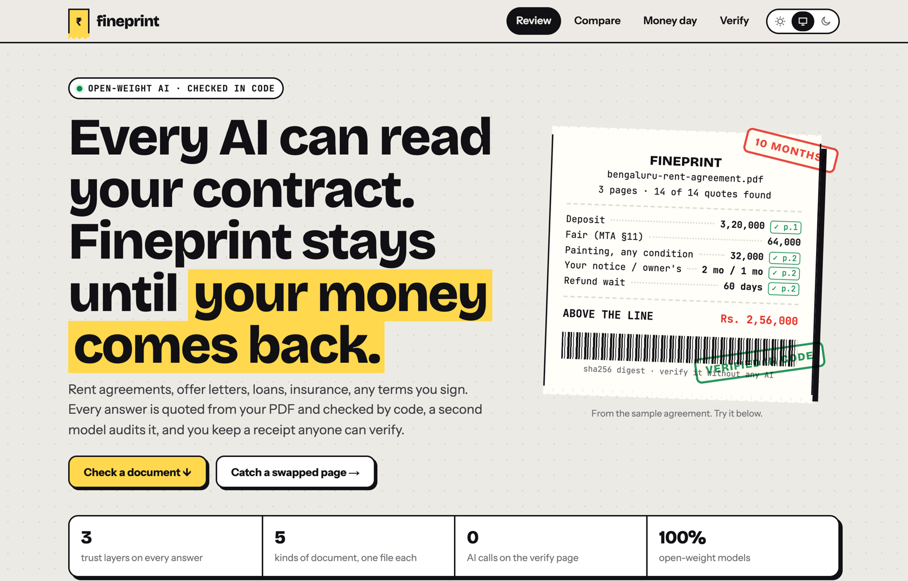
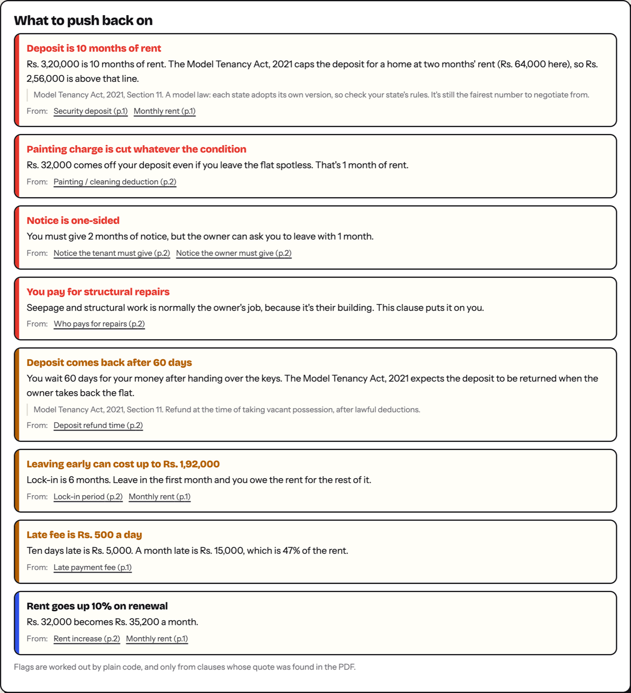
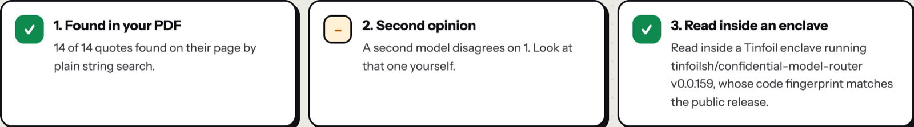
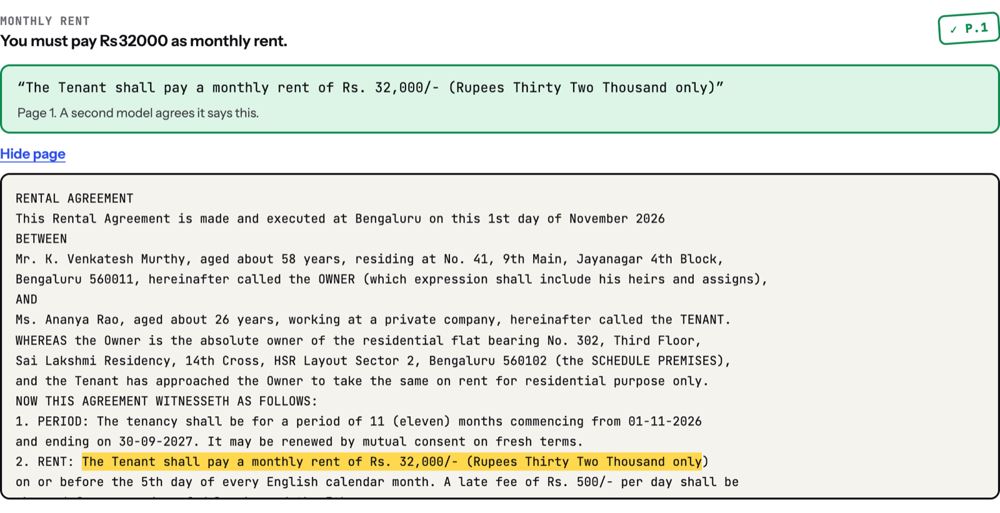
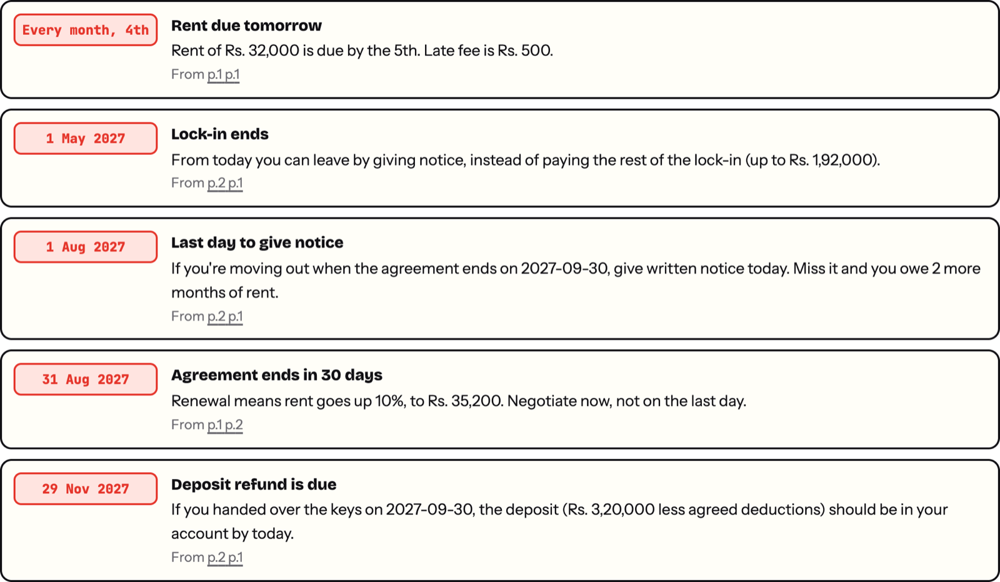
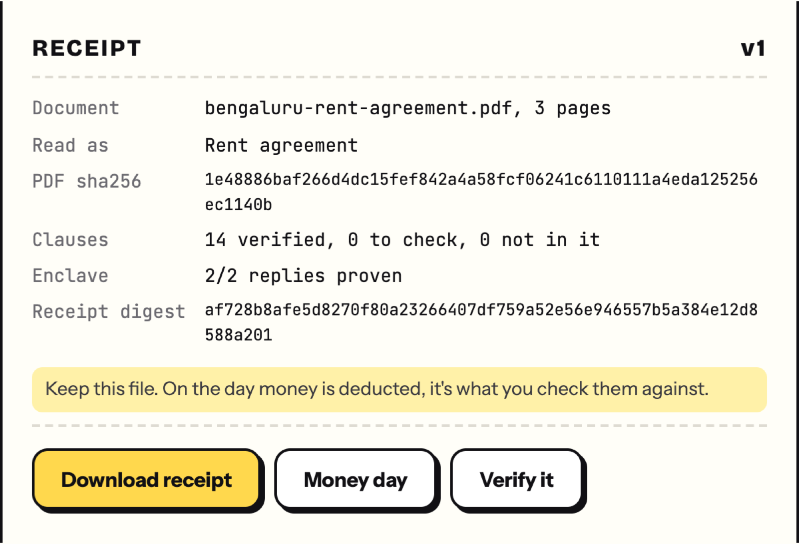
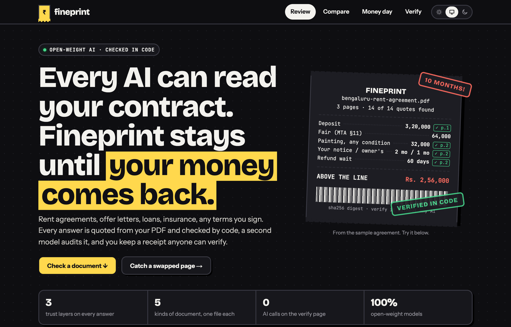
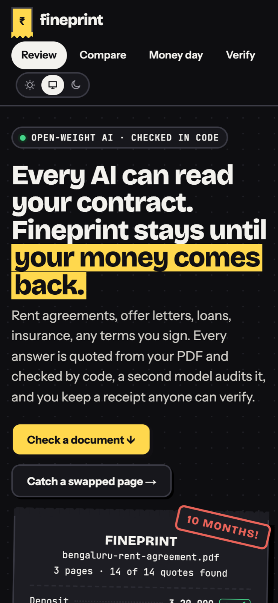
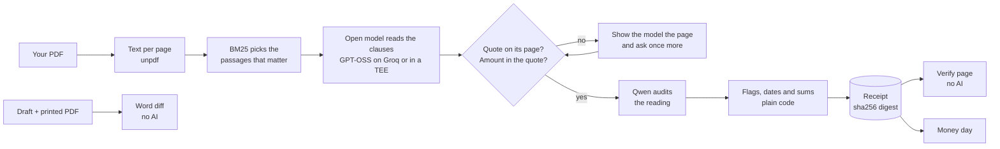

<div align="center">

# Fineprint

**Every AI can read your contract. Fineprint stays until your money comes back.**

Fineprint reads the fine print and hands you a receipt. Every claim is quoted from your PDF and checked in code, a second model audits it, and anyone can verify the receipt later without any AI.

[](https://github.com/abjt01/fineprint/actions/workflows/ci.yml)
[](https://github.com/abjt01/fineprint/actions/workflows/docker.yml)
[](LICENSE)


**Hacktoberfest Hack Day Bengaluru 2026** · Track 02, Best Open-Source AI Project · Problem statement O3, Trustworthy and Verifiable AI



</div>

## Contents

- [The problem](#the-problem)
- [Four moments](#four-moments)
- [What it catches](#what-it-catches)
- [Why you can trust it](#why-you-can-trust-it)
- [How it works](#how-it-works)
- [Run it](#run-it)
- [Docker](#docker)
- [Configuration](#configuration)
- [Project layout](#project-layout)
- [Tests and CI](#tests-and-ci)
- [Limits](#limits)
- [Contributing](#contributing)

## The problem

People don't lose money on the day they read a contract. They lose it on other days:
- at the signing desk, when the printed copy isn't the draft they agreed to on WhatsApp;
- months later, when they miss a notice deadline by a week;
- on the last day, when a landlord keeps Rs. 45,000 of the deposit "for painting and cleaning".

AI can summarise a contract, but you can't tell when it's wrong. It can say your deposit comes back in 30 days when the agreement says 60, and sound just as sure. So Fineprint never asks you to trust it. Every answer points at a line on a page that code has found, and the result is a receipt you can check without any AI.

## Four moments

| When | What Fineprint does | Who decides |
| --- | --- | --- |
| **Before you sign** | Works out what kind of document it is (rent agreement, job offer, loan, health insurance or any contract). It reads out the clauses that cost money, each with its line and page, and flags what to push back on. | The model reads. **Code** checks every quote and works out every flag. |
| **At the signing desk** | *Printed ≠ promised.* Compares the draft with the copy you're asked to sign, word by word, and shows every change with its page in both. | **Code only**, no model |
| **While you live with it** | *Trap alarms.* A calendar file with the days the contract costs money: last day to give notice, lock-in ends, renewal, deposit refund due, rent day. | **Code**, from verified dates |
| **Money day** | Paste the landlord's WhatsApp. Each deduction is checked against the receipt you saved at signing: agreed, over the limit, not in the agreement, or ask for the bill. You get a reply with page numbers in it. | The model splits the message. **Code** decides and writes the reply. |

You can also **ask the document anything** (every sentence of the answer carries its own proof) and **check what ChatGPT told you** about it (each claim comes back right, wrong, or not in the document).

## What it catches

These examples use the invented samples in [`public/`](public).

**Rent agreement:**
- Deposit of 10 months' rent: Rs. 2,56,000 above the Model Tenancy Act's two-month line (Section 11).
- A Rs. 32,000 painting cut "irrespective of the condition".
- You give 2 months' notice, the owner gives 1.
- You pay for structural repairs.



**Personal loan sold at "14% flat":**
- Code redoes the EMI maths: the real rate is **24.9%**.
- Counting the Rs. 5,400 taken off at disbursal, it's **35.9%** on the money you actually get.


**Fresher's offer letter:**
- A Rs. 2,00,000 training bond.
- A 90-day notice period. Buying it out costs about Rs. 1,18,356.
- 18% of the CTC isn't guaranteed.
- A non-compete (Indian Contract Act, Section 27).

**Health insurance:**
- A 20% co-pay on every claim.
- A room-rent cap with proportionate deduction.
- 36 months' wait for existing illnesses.

**Draft vs printed copy:** five quiet changes are caught, with no AI involved:
- deposit 1,92,000 → 3,20,000
- owner's notice 2 months → 1
- painting "as per bills, max 10,000" → "one month's rent irrespective of condition"
- refund 15 days → 60


**Money day:** Rs. 45,000 claimed, Rs. 37,000 allowed, Rs. 2,83,000 owed back, and a reply ready to paste.


<details>
<summary>More screenshots</summary>

| | |
| --- | --- |
|  |  |
|  |  |
|  |  |
|  |  |

</details>

## Why you can trust it

There are three layers. Each one can be checked by someone who doesn't trust the one before it.

| Layer | What it proves | How |
| --- | --- | --- |
| **1. Found in your PDF** | The line exists and the number is in it | Plain code finds every quote on its page (exact, or 85% of its words close together) and checks the amount is written in the quote. If it isn't, the model is shown the page and asked once more (self-correction). If it still can't point at the line, the answer gets a red **? check** stamp instead. |
| **2. Second opinion** | The line was read the right way | Qwen, from a different model family, reads each verified quote next to the answer and says whether the quote supports it. It catches a real line read wrongly. |
| **3. Read inside an enclave** | Known, published code on real enclave hardware read the document, and nobody else could see it | In TEE mode, GPT-OSS 120B runs in a hardware enclave. With **Tinfoil** (free to start), the SDK checks the enclave's attestation before connecting: its measured code must match the published release. The request is then encrypted to that enclave's key. With a **signing provider** (RedPill / Phala), the enclave signs `sha256(request):sha256(response)`. The app checks the ECDSA signature against the address in a fresh attestation report. |

On top of that:

- **Flags, dates, sums and diffs are plain code.** The model only reads text out. The rules live in [`lib/packs/`](lib/packs), one file per kind of document, and they only run on verified clauses, so every flag links to a real line.
- **The receipt** is one JSON file. It holds the PDF's sha256, a hash of every page, every clause with its quote, page, stamp and audit, the flags and the enclave proofs, all under one canonical digest. The format is in [RECEIPT_SPEC.md](RECEIPT_SPEC.md), so other tools can write and check receipts too.
- **The verify page uses no model.** It re-hashes the receipt and checks that each amount is in its own quote. It finds every quote in the PDF again and re-checks the enclave proofs. **Tamper with it** changes one number so you can watch it fail.

## How it works



**Open-source and open-weight all the way down:**
- GPT-OSS 120B and GPT-OSS 20B read documents, and Qwen 3.8 27B audits.
- They're served free on Groq by default. You can also use any OpenAI-compatible server (Ollama, vLLM, llama.cpp) with `LLM_BASE_URL`, or run inside a TEE with `TINFOIL_API_KEY` or `TEE_BASE_URL`.

## Run it

You need Node 20 or newer and a free [Groq key](https://console.groq.com/keys).

```bash
git clone https://github.com/abjt01/fineprint.git
cd fineprint
npm install
cp .env.example .env   # add GROQ_API_KEY
npm run dev            # http://localhost:4300
```

Click one of the samples (rent agreement, offer letter, personal loan), or drop in your own PDF.

## Docker

```bash
docker compose up --build            # http://localhost:3000, keys read from .env at run time
# or
docker build -t fineprint .
docker run -p 3000:3000 --env-file .env fineprint
```

The image never contains `.env` or any key (see [`.dockerignore`](.dockerignore)). It runs as the unprivileged `node` user and has a health check on `/healthz`. Each push to `main` publishes it to `ghcr.io/abjt01/fineprint`.

## Configuration

Every setting is an environment variable. See [`.env.example`](.env.example).

| Variable | What it does |
| --- | --- |
| `GROQ_API_KEY` | Groq key for the open-weight models. Required unless you use `LLM_BASE_URL`. |
| `GROQ_API_KEYS` | More Groq keys, comma-separated. Each key gets its own per-minute budget. A key that hits a rate limit rests while the others carry on, and a rejected key drops out ([`lib/keys.js`](lib/keys.js)). `npm run keys` checks them all. |
| `TINFOIL_API_KEY` | Turns on TEE mode with Tinfoil. You can sign up free at [tinfoil.sh](https://tinfoil.sh). |
| `TEE_BASE_URL`, `TEE_API_KEY`, `TEE_MODEL` | TEE mode with a provider that signs each reply (RedPill / Phala style). |
| `LLM_BASE_URL` | Any OpenAI-compatible server instead of Groq. |
| `READ_MODEL`, `READ_MODEL_SMALL`, `AUDIT_MODEL` | Swap the models. |
| `RATE_LIMIT_SCALE`, `MAX_AI_JOBS`, `DISABLE_RATE_LIMIT` | Tune rate limits ([`lib/ratelimit.js`](lib/ratelimit.js)): per-IP windows per route, a daily AI cap, and a limit on AI jobs running at once. Every answer carries `RateLimit-*` headers, and a 429 carries `Retry-After`. |

Keys only ever live in `.env` or in the host's environment. They are never in the repo or the image.

## Project layout

```
app/                 pages (review, compare, money day, verify) and API routes
components/          UI: checker, clause rows, alarms, ask box, compare, money day, verifier
lib/
  pdf.js             text per page
  search.js          BM25 passage picking
  verify.js          finds quotes in PDF text despite line breaks and Indian number formats
  reader.js          reads clauses, checks quotes, one self-correcting retry
  packs/             rent, job, loan, insurance, general: clauses, rules, summary
  auditor.js         the second opinion
  diff.js            draft vs printed, word by word
  alarms.js          dates that cost money, from verified clauses
  settle.js          deductions checked against a receipt, reply written by code
  ask.js             ask a document; fact-check another AI
  tee.js             enclave proofs (Tinfoil attestation, signed replies)
  receipt.js         building and checking receipts
  keys.js            Groq key rotation
  ratelimit.js       rate limits and AI job slots
public/              sample PDFs (all invented)
scripts/             sample generator, key checker
test/unit/           node:test suites
```

Want a new kind of document, such as a phone plan, a school admission form or a car lease? Add one file to `lib/packs/` with its clauses, its rules and its summary. See [CONTRIBUTING.md](CONTRIBUTING.md).

## Tests and CI

```bash
npm test      # quote checks, packs, loan maths, diff, alarms, receipts, signatures, key pool, rate limits
npm run keys  # checks every Groq key and says which to replace
```

- **ci:** unit tests and a production build on Node 20 and 22. Then a smoke test starts the app and checks the pages, the draft-vs-printed comparison and receipt verification. None of these need an API key.
- **docker:** builds the image, runs it and checks it answers. It publishes to GitHub Container Registry on pushes to `main` and on version tags.
- **Dependabot** keeps npm packages, actions and the base image up to date.

## Limits

- Text PDFs only. A scanned document has no text to quote, and Fineprint doesn't pretend to OCR it.
- Flags are a starting point for a conversation, not legal advice. The only legal references are the Model Tenancy Act, 2021 (Section 11) and the Indian Contract Act, 1872 (Section 27), each with a note on how far it goes.
- Without TEE mode, layer 3 is off, and the app says so on screen. Layers 1 and 2 still hold.

## Contributing

Issues and pull requests are welcome. Start with [CONTRIBUTING.md](CONTRIBUTING.md), and please read the [Code of Conduct](CODE_OF_CONDUCT.md). For security issues, see [SECURITY.md](SECURITY.md).

The PDF, search and quote-matching code started from my earlier project [Form Bhaiya](https://github.com/abjt01/form-bhaiya) (MIT, built 14 October 2026), which checks government exam notices the same way. Everything else was built for this hackathon.

## License

[MIT](LICENSE) © 2026 Abhijeet Yadav
